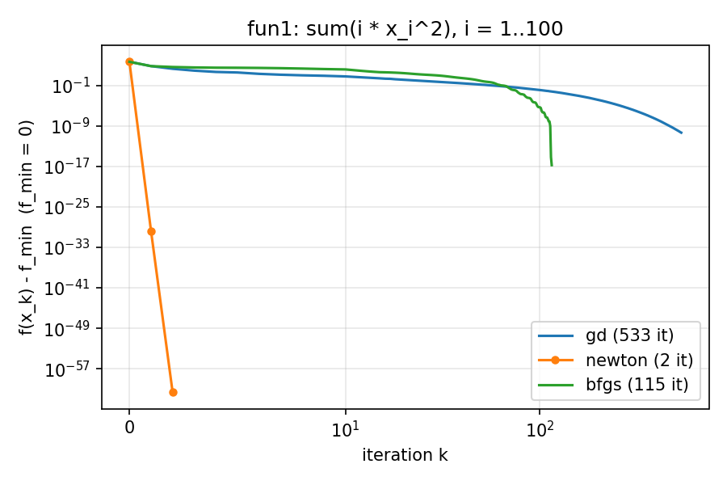
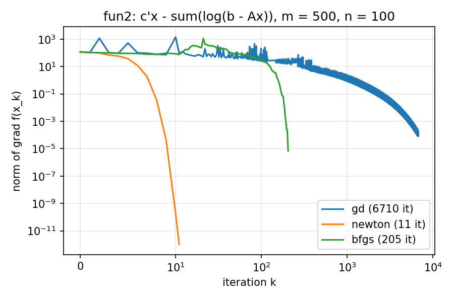
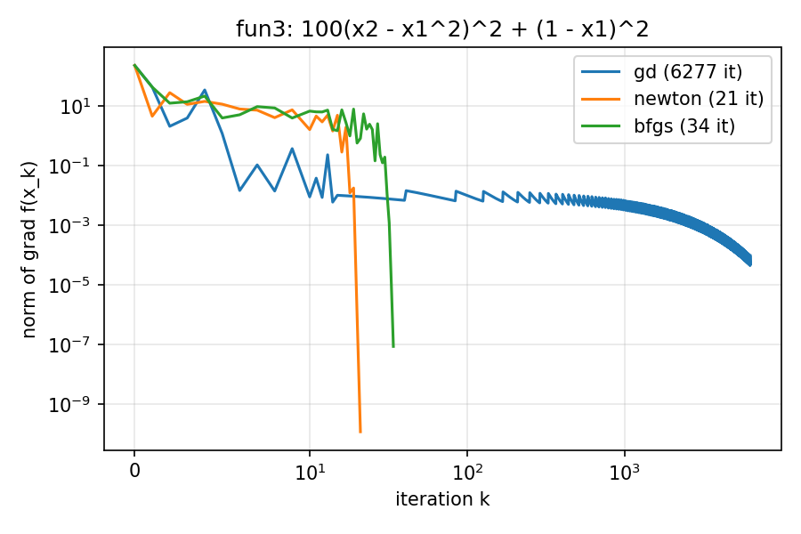

# CISC-820 Project 2

Group 1: AJ Barea, Hem Raj Pandeya, Jinting Liu, Max Frohman

Gradient descent, Newton and BFGS, run on three functions: the in-class half in `inside/`,
our outside project in `outside/`.

## Setup

```bash
python3 -m venv .venv          # Python 3.12 or newer
source .venv/bin/activate      # Windows: .venv\Scripts\activate
pip install -r requirements.txt
```

## The three functions

| | f(x) | n | Start |
|---|---|---|---|
| fun1 | `sum(i * x_i^2)`, i = 1..100 | 100 | `ones(100)` |
| fun2 | `c'x - sum(log(b - Ax))` | 100 | `zeros(100)` |
| fun3 | `100(x2 - x1^2)^2 + (1 - x1)^2` (Rosenbrock) | 2 | `(-1.2, 1.0)` |

## The methods

| Name | Method |
|---|---|
| `gd` | Gradient descent |
| `newton` | Newton |
| `bfgs` | Quasi-Newton: BFGS |

## Running the code

```bash
python inside/run.py                                # every method on every function
python inside/run.py -functions fun3 -methods bfgs  # a subset (methods: gd, newton, bfgs)
```

It prints one row per function and method: f at the solution, the gradient norm there,
the iterations and the time, and saves one plot per function to `inside/results/`.
`--tol` changes the stopping rule (default 1e-12); `--no-plot` skips the figures.

## Result Table

Times vary from run to run.

| Function | Method |           f(x*) | norm grad f(x*) | Iterations | Seconds |
|----------|--------|-----------------|-----------------|------------|---------|
| fun1     | gd     | 4.918422049e-11 |        3.66e-05 |        533 |   0.059 |
| fun1     | newton |               0 |        0.00e+00 |          2 |   0.001 |
| fun1     | bfgs   | 1.829954299e-17 |        5.35e-08 |        115 |   0.024 |
| fun2     | gd     |    -2443.247657 |        1.69e-04 |       6671 |   2.380 |
| fun2     | newton |    -2443.247657 |        1.60e-10 |         11 |   0.006 |
| fun2     | bfgs   |    -2443.247657 |        1.01e-05 |        202 |   0.059 |
| fun3     | gd     | 1.457646837e-09 |        9.76e-05 |       6277 |   0.475 |
| fun3     | newton | 7.682025129e-24 |        1.22e-10 |         21 |   0.001 |
| fun3     | bfgs   | 2.745652475e-17 |        8.83e-08 |         34 |   0.002 |

## Convergence Plots







`fun1_convergence.png`: `f(x_k) - f_min` per iteration, since fun1's minimum is given.

`fun2_gradient_norm.png`, `fun3_gradient_norm.png`: the norm of grad f(x_k) per iteration.
Their minima are not given, so these show progress without assuming one.

## Lowest f Found

| Function | f(x*) | Method |
|---|---|---|
| fun1 | 0 | newton |
| fun2 | -2443.247657 | newton |
| fun3 | 7.682025129e-24 | newton |

## Comments

Newton takes the fewest iterations and the least time on all three functions, then BFGS,
which needs no Hessian. On fun1, a quadratic, Newton is exact in 2 iterations. fun3
(Rosenbrock) is not quadratic, so Newton needs 21. Gradient descent takes 533 to 6,671
iterations.